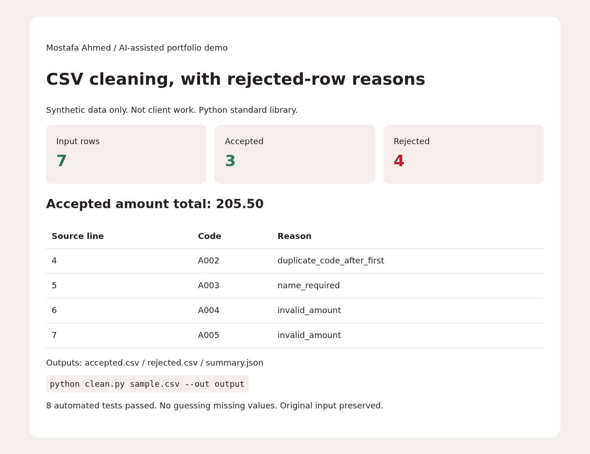

# CSV cleaning and rejection report

Mostafa Ahmed / AI-assisted portfolio demo. Synthetic sample only, not client work. No employer data or code.

Python 3.10+ standard library. No install, server or network.
```sh
python clean.py sample.csv --out output
python -m unittest -v
```

Input: UTF-8 CSV with exact headers code,name,amount. Trims whitespace, validates uppercase codes and required names, checks nonnegative decimal amounts with up to 2 decimals and maximum 1,000,000. Keeps first valid occurrence of each code, rejecting later duplicates. Does not deduplicate names or infer missing values. No XLSX support is claimed.

Output: accepted.csv, rejected.csv with source line/reasons, summary.json with counts and accepted amount total. Original input never overwritten. Blank/malformed rows are rejected, wrong header stops the run. Keep source files for investigation.

Expected synthetic fixture: 7 rows, 3 accepted, 4 rejected, total 205.50 (fictional EGP). Educational tool, not a production ETL or a guarantee of data truth. Arbitrary user text is preserved: use text import rather than opening CSV from unknown sources directly in Excel. Never use sensitive data in a public demo.



[Download source ZIP](1-csv-cleaning-demo.zip). Extract before running.
